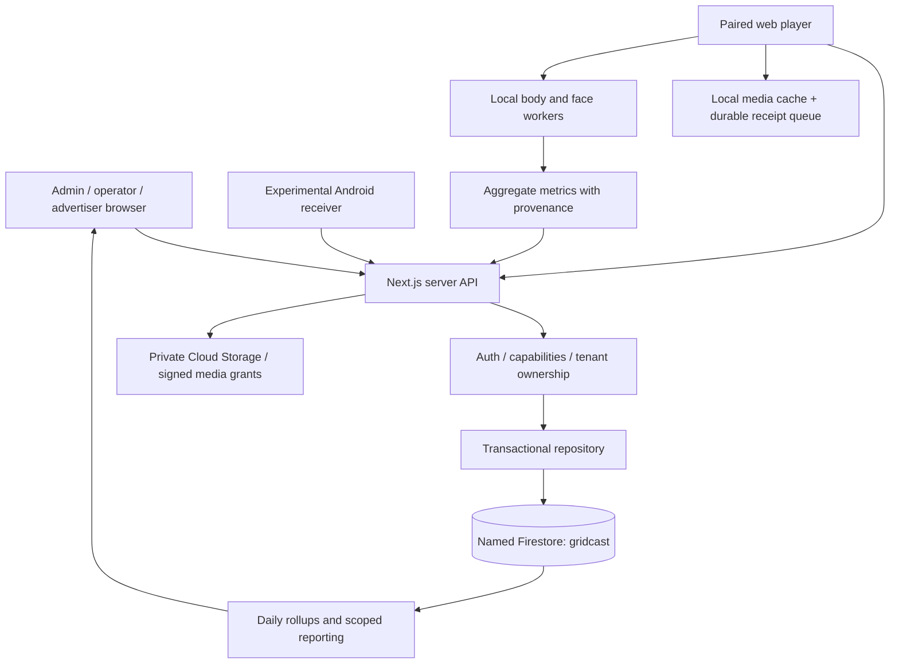

# Gridcast — developer handover

Prepared 27 October 2026. Audience: the human developer taking over from Sanan and the AI-assisted build team.

This replaces the September chat handover. It describes the inspected source and dated release evidence, not a new production certification. No passwords, tokens, auth codes, private company address or camera data belong in this document. The prior handover remains recoverable through Git history.

## 1. Start here

Gridcast is a multi-tenant digital-out-of-home advertising platform: organizations operate venue screens, advertisers supply creatives, campaigns select inventory, and paired receivers play media while optionally measuring people and attention locally. The dashboard handles administration, configuration, review, reporting and commercial records. The browser receiver already exists; a native Android receiver is an experimental companion, not a completed replacement.

| Item | Location / state |
| --- | --- |
| Application source | `https://github.com/sananxrom/Gridcast` |
| Working branch | `codex/gridcast-trust-layer-wp5` — historical name, contains later features |
| Local source on Sanan's Mac | `/Users/sanan/Downloads/gc` |
| Desktop chat workspace | `/Users/sanan/Documents/Claude/Projects/Gridcast` — NOT the app source |
| Product | https://app.gridcast.si |
| Browser receiver | https://app.gridcast.si/player |
| Firebase fallback hostname | https://gridcast-backend--gridcast-508011.asia-southeast1.hosted.app |
| Public landing site | https://gridcast.si — separate Vercel project/repository |
| Source HEAD before this document | `a435de91250afbb950ba2032ff608751dc51984f` |
| Last verified product release | `9308211a52892882e425e83ae111b3f770c599f5`, verified 13 October 2026 |
| Last verified Firebase rollout | `build-2026-10-12-001`, READY / SUCCEEDED / 100% traffic |

**Release evidence is historical:** live cloud state was not rechecked for this documentation task. The latest log-only commit is not necessarily the deployed code commit. Do not assume `main` is the current product branch or deploy an old Vercel application URL.

### First-hour checklist

1. Get repository access from Sanan and clone the working branch shown above.
2. Read this document, then the recent `AI-LOG.md` entries. Inspect `git status`, branch and HEAD before any change.
3. Start the app with an isolated local file database; do not use cloud data for tests.
4. Trace one campaign from draft to review/activation, playlist authorization, playback receipt and report.
5. Get separately authorized Firebase/GCP, Vercel and Hostinger access if your role includes operations. A Git clone does not grant cloud access.
6. Resolve the local-only Android/source transfer described below before assuming you have the entire project.
7. Agree the next deliverable with Sanan. Old research plans are context, not an instruction to implement every proposed feature.

## 2. Critical transfer gap: not everything is in Git

At inspection, the web application is tracked but **`android-player/` is untracked**, as is `gridcast-research/32-native-android-receiver.md`. The Android APK and sources therefore do not arrive in a normal clone. This handover commit does not silently publish those unrelated files.

Arrange an explicit reviewed Android source commit or a secure source transfer from Sanan's Mac. Include the Gradle wrapper, Kotlin sources, manifest/resources, tests and README. Exclude local SDK paths, build caches, generated outputs, credentials and signing keys. A debug APK alone is not a source handover. Establish release signing separately before distributing a production fleet APK.

Other pre-existing local changes at handover: modified `.gitignore`, `AGENTS.md`, `CLAUDE.md`, `TEAM.md`; untracked agent-tool directories, `.graphifyignore`, `skills-lock.json`, `Claude outputs/`, `06-phase1-build-spec.md`, research documents 00–09 and 20. `AI-LOG.md` also has later entries being included with this handover. Review ownership/content before transferring any of these. Never use `git add .` to bundle them accidentally.

## 3. Product decisions that must survive takeover

- Platform admin needs access across organizations; ordinary operators remain isolated from unrelated tenants. “All organizations” is the administrator's aggregate scope; “Gridcast” selects Gridcast's own tenant.
- Advertiser accounts are scoped to a particular advertiser. The advertiser workspace is not the operator's entire account.
- Creatives support uploaded media and online YouTube. Editing must show the saved preview and allow changing source/replacing media. Changed content needs approval again; approval is per creative and reused across campaigns.
- Campaign drafts can be incomplete and resumed. Submission, creative approval, activation, scheduling and actual delivery are different states. Do not label something “live” simply because it was saved or approved.
- Creative duration determines playback length. Images have a manually editable duration, default 20 seconds. Screens can impose minimum/maximum creative duration.
- There must be no deliberate three-second padding or long blank tail after the rotation. Repeat eligible content continuously; preload/cache uploaded media. Filler is separate noncommercial content when paid content is unavailable.
- “Keep playing offline” is a product goal, not permission to bypass paid authorization, erase evidence or invent billable plays. Expired paid authorization and exhausted storage require explicit behavior; see the known Android gap.
- Full body AND face CV is the default replacement. Do not restore the retired COCO-only production path or require per-screen opt-in to get the new pipeline.
- Camera/model sessions persist across ads. Per-ad metrics reset; the camera and model initialization should not.
- Calibration is optional. Default offsets are valid operation. Failure of calibration or CV must not block ads.
- On-screen diagnostics are optional. When enabled, retain camera preview, body/face boxes and useful live metrics, not just a vague setup message. Normal playback should be clean.
- Feed relevant aggregate measurements into existing dashboards and downloadable reports. Do not create a separate reporting product merely because measurements came from the new pipeline.
- User initially described all screens as controlled development/test devices; a café field test subsequently occurred. Reconfirm current venue/customer exposure before destructive changes. Re-pairing was acceptable during development, but revocation still strands old receipts under their original device identity.
- Branding: supplied Gridcast symbol, solid gold/ochre rather than excessive gradient, readable wordmark and compact Platform label.

## 4. Architecture and why it is structured this way



The web app is a Next.js monolith with browser UI, server handlers and shared domain libraries. It is not a collection of separately deployed microservices. Most JSON API routing is centralized in `lib/api.ts`; the catch-all route passes method/path/query/body/token into it. Upload/media handlers are separate because they have binary and streaming requirements.

Production persistence uses server-side Firebase Admin access, not client Firestore queries. `lib/firestore-store.ts` adapts the domain operations into scoped Firestore reads and per-document transactional writes. Authentication/ownership decisions must remain within the transaction where relevant; callbacks can retry, so avoid irreversible external side effects inside them.

This evolved from a pilot JSON store. `lib/store.ts` still supports file/Redis/memory compatibility modes. These are not production-equivalent guarantees. Do not “simplify” cloud operation by switching to whole-blob writes or ephemeral memory.

Offline media availability, permission to play, evidence of playback and measurement availability are four separate concerns. Downloading a video does not authorize indefinite paid playback. Successful playback does not prove a person watched. A camera failure does not mean zero people.

### Stack

- Next.js 15.5.26, React 18.3.1, TypeScript; App Router.
- Tailwind CSS 3, Radix primitives, Lucide icons, Framer Motion.
- Firebase Admin 14.x; Firestore and private Cloud Storage.
- Browser IndexedDB/cache machinery for queue, assignments and media.
- Playwright-driven browser tests wrapped in Node's test runner; Node `.test.cjs` domain tests.
- Native prototype: Kotlin, Media3, MediaPipe, SQLite; details below.

Use `package-lock.json` and `npm ci` for exact JavaScript dependency resolution. Versions in prose are a snapshot, not an instruction to upgrade.

## 5. Source map

| Area | Primary files |
| --- | --- |
| Route entry points | `app/page.tsx`, `app/admin/page.tsx`, `app/operator/page.tsx`, `app/advertiser/page.tsx`, `app/control/page.tsx` |
| Shared shell/navigation | `components/ui/app-shell.tsx`, `sidebar-nav.tsx`, `command-palette.tsx`, `lib/nav.ts`, `lib/client.ts` |
| API entry / domain dispatch | `app/api/[...path]/route.ts`, `lib/api.ts` |
| Authentication / permissions | `lib/auth.ts`, `lib/access.ts`, `lib/roles.ts`, `lib/audit.ts` |
| Repository | `lib/store.ts`, `lib/firestore-store.ts`, `lib/seed.ts` |
| Campaign lifecycle | `lib/campaign-status.ts`, `lib/campaign-drafts.ts`, `components/views/campaign-flow.tsx`, `campaign-list.tsx`, `campaign-detail.tsx`, `campaign-dashboard.tsx` |
| Advertiser UI | `components/views/advertiser-workspace.tsx` |
| Creative editor/media | `components/views/creative-upload.tsx`, `lib/media.ts`, `app/api/assets/upload/route.ts`, `app/api/media/route.ts` |
| Inventory and rotation | `lib/inventory.ts`, `lib/rotation.ts`, `lib/readiness.ts`, `components/views/groups.tsx`, `screen-detail.tsx` |
| Device authorization / receipts | `lib/devices.ts`, `lib/budgets.ts` |
| Player lifecycle | `app/player/page.tsx` |
| Offline evidence / media | `lib/player-queue.ts`, `lib/player-media-cache.ts`, `lib/player-evidence-lock.ts` |
| Config layering | `lib/config.ts`, `components/views/config-views.tsx` |
| Full CV | `lib/vision/production-v2.ts`, `presence-v2-profile.ts`, `measurement-binding-v2.ts`, `attention-v2-contracts.ts`, `metrics.ts`, `engine.ts`, `a2-scheduler.ts` |
| CV display/performance/calibration | `lib/vision/local-diagnostics-v2.ts`, `performance-telemetry.ts`, `calibration.ts`, `camera-calibration.ts`, `lib/player-vision.ts` |
| CV browser assets | `public/vision-lab/`, especially profile manifest and separate body/face workers |
| Reporting/economics | `lib/reporting.ts`, `lib/metrics.ts`, `lib/settlement.ts`, `components/views/delivery-report.tsx`, `report-*`, `settlement.tsx` |
| Maintenance/diagnostics | `lib/maintenance.ts`, `lib/player-maintenance.ts`, `lib/diagnostics.ts`, `lib/player-diagnostics.ts`, `app/player/maintenance/page.tsx`, screen maintenance/diagnostic views |
| Deployment/security metadata | `apphosting.yaml`, `firebase.json`, `.firebaserc`, `firestore.rules`, `firestore.indexes.json`, `app/robots.ts`, `next.config.*` |
| History and design reasoning | `AI-LOG.md`, `gridcast-research/` |

Some files retain historical or evaluation names. A filename containing “production” or “lab” alone is not proof of its active use; trace imports from the current player/profile.

## 6. Data model, tenancy and reporting

The principal domain collections are `orgs`, `users`, `screens`, `advertisers`, `creatives`, `campaigns`, `groups`, `devices`, `configs`, `assets`.

Evidence and operational collections include `plays`, `presence`, `device_assignments`, `measurement_bindings`, `audit`, `diagnostic_results`, `attention_calibrations`, `maintenance_grants`, `maintenance_limits`, `diagnostic_assignments`, `settlement_buckets`, `campaign_budgets`, `screen_day`, `attention_day`, `campaign_drafts`. Auxiliary uniqueness/sequence documents enforce identity and deduplication. Inspect `lib/firestore-store.ts` for exact key generation and lookup scopes before altering schema.

Organizations own inventory and commercial entities. Users belong to an organization, with advertiser viewers further restricted by advertiser identity. Campaigns link advertisers, creatives and selected screens. Groups assist inventory selection; do not silently expand a saved campaign because group membership changes. Devices represent a particular pairing lifetime. Assignments authorize finite delivery and bind configuration/measurement provenance. Plays are idempotent receipts, not mutable dashboard counters.

Roles: `platform_admin`, owner (including legacy `org_admin`), manager, sales, installer, `advertiser_viewer`. Capabilities are `screens`, `sales`, `money`, `team`, `org`, `platform`; inspect `lib/roles.ts` and `lib/access.ts`. UI hiding is not authorization. Advertiser receipt responses intentionally redact internal fields.

Config resolves platform → organization → group → screen, with most specific allowed overrides. Measurement/privacy/transport keys marked locked are platform-only and enforced server-side. Some schema settings are explicitly `soon`; their presence is not evidence that the runtime implements them.

Reporting uses bounded raw history and daily rollups. The repository retains a 2,000 domain read limit and 1,500 raw history limit; paginated reporting is not the same as unlimited raw-event access. Preserve coverage/truncation notices. Do not calculate “all time” by summing a limited bootstrap response. Test pagination, time boundaries, tenant filters and CSV consistency when changing reports.

Commercial records, reserved budgets, settlement calculations and payout displays are not a finished external accounting/payment integration. Preserve original booking rates and economic provenance. Do not infer certified billing, bank transfer completion or automated invoicing from UI totals.

## 7. Authentication and security model

Authentication is custom application auth, **not Firebase Authentication**. Passwords use salted PBKDF2-SHA256; signed session tokens use HMAC. Current source uses 60,000 PBKDF2 iterations and a seven-day session duration; review these as part of a deliberate security assessment rather than assuming compliance certification. Authentication versioning/revocation and current user state matter, not just a client role string.

Production requires `GC_AUTH_SECRET` of at least 32 characters, supplied through Secret Manager. No production source-visible fallback is permitted. Local process-random signing is possible, but a configured local secret makes sessions stable across restarts.

Direct browser Firestore reads/writes are denied by `firestore.rules`. Server IAM access bypasses those client rules, so API authorization is indispensable. Never expose admin credentials to frontend code. Private media uses authorized signed transfers; uploaded file type, dimensions, duration, size and asset hashes are validated in the media path.

Pairing issues device-specific credentials. A bare `screen_id` is not authorization. One-time maintenance authority is distinct from ordinary player authority and protects privileged diagnostic/export/recovery functions. Do not replace it with a shared hard-coded PIN.

Do not restore unauthenticated reset, shared seed passwords, arbitrary object assignment into protected fields, client-supplied impersonation or cross-tenant bootstrap leaks. Existing tests are regression protection, not a claim that the application has passed an independent penetration test.

## 8. Receiver lifecycle and offline contracts

1. Generate a one-use eight-character pairing code from a screen's dashboard; enter on `/player` within its ten-minute lifetime.
2. Pairing authenticates the receiver and replaces/revokes the previous device credential for that screen.
3. Fetch `/api/playlist/:screenId` using the device token (current player protocol 3). The response includes assigned content, config/version, server time, validity, readiness and diagnostics offers.
4. Select eligible rotation content, acquire/verify uploaded assets and reserve local evidence capacity/allowance before a play.
5. Render with real media progress; collect eligible CV observations independently.
6. Finalize a receipt with stable `play_uid`, monotonic device sequence, original assignment/device/config/binding and timestamps; enqueue durably.
7. Retry the identical receipt through `/api/play`. Heartbeats and diagnostic/calibration/maintenance endpoints are separate operational paths; see `lib/devices.ts` and `lib/api.ts` for their exact request contracts.

Uploaded-only assignments can last up to 24 hours, shortened by campaign/schedule constraints; mixed/online media uses a shorter window. `valid_until`, `accept_until` and `max_plays` mean different things. The 72-hour backlog acceptance window does not authorize 72 hours of new offline plays.

`lib/player-media-cache.ts` verifies asset hash and byte count and stores ready schedules with authorization state. YouTube is online-only and is never promised offline. Browser storage is evictable; caching is not an unconditional persistence guarantee.

`lib/player-queue.ts` reserves evidence space, bounds retained records at 5,000 and preserves blocked/stranded entries. Retry/recovery must keep original identity. Do not clear IndexedDB or re-pair as the first response to a blocked queue without understanding evidence loss. Queue exhaustion is an integrity constraint; explain it rather than silently dropping receipts to keep billing.

Browser proof of play is authenticated software evidence, not hardware attestation that the physical panel was visible or that a person watched it.

## 9. CV: the full current system

The current profile in `lib/vision/presence-v2-profile.ts` is:

| Parameter | Value |
| --- | --- |
| Profile | `presence-v2/efficientdet-lite0-mediapipe-face/1` |
| Body | `efficientdet-lite0-int8/1` |
| Face | `face-landmarker-float16/1` |
| Web runtime | `mediapipe-tasks-vision@1.0.1` |
| Metric schema | `attention-v2/1` |
| Body input / scheduling interval | 320 px / 333 ms |
| Face input / scheduling interval | 640 px / 125 ms |
| Body / face limits | 20 / 5 |
| Default confidence | 0.4 |
| Default calibration | zero offset |

These are configured intervals, not promised achieved FPS. Exact model, manifest, worker and pipeline hashes live in the profile/manifest and measurement binding code. Treat them as a versioned contract: changing workers/model/preprocessing without updating provenance can cause receipts to be rejected or mislabeled.

The body and face stages run independently with freshness/recovery handling. Body-led observations and temporary association feed attention metrics; a face alone must not create a counted person. Worker WebGL 2 is a known compatibility boundary. Old iMac Safari reported it unavailable; Chrome on that machine was reported working. Do not assume all Safari versions fail or that the Chrome result proves long-duration reliability.

The old COCO/V1 execution and user-facing opt-in were removed. Historical legacy receipt validation remains for old data. README text still claiming active COCO is stale; do not reintroduce it from that text.

### Measurement semantics and privacy

- Historical `avg_persons` is average sampled presence, not unique reach or impressions.
- New estimated impressions/attention/visible-smile metrics have separate definitions in the metric contracts. They are estimates, not certified audience delivery or a new billing basis.
- No valid observation = unavailable/null. A valid observation of an empty scene can be measured zero. These must not collapse together.
- Temporary visit tracking, face landmarks and visible smiles were explicitly accepted by Sanan after the initial no-tracking policy. Older blanket prohibitions are superseded; identity recognition, re-identification and demographics are not part of this scope.
- Face direction estimates looking toward a screen, not precise eye tracking. Visible smile is not happiness, preference or ad effectiveness.
- Frames, face geometry, boxes and temporary track identities stay local. Aggregate reports retain provenance and availability.
- Optional calibration changes offsets, not permission to start ads. If calibration fails, retain the prior/default settings and continue.
- On-screen diagnostics should show current counts, body/face boxes, per-ad metrics and stage performance when enabled. Dashboard cards/reports receive relevant aggregate data; remote camera streaming is not implemented.

## 10. Local development and verification

```bash
git clone --branch codex/gridcast-trust-layer-wp5 https://github.com/sananxrom/Gridcast.git
cd Gridcast
npm ci
cp .env.example .env.local
```

Set locally generated private values for `GC_DEMO_PASSWORD` (12+ characters) and `GC_AUTH_SECRET` (32+). Leave `GC_STORE` unset for local file storage and remove inherited Redis/Upstash credentials and `VERCEL` environment flags. The local database is `data/db.json`; existing data is not reset automatically. Do not copy real user data into a public fixture.

```bash
npm run dev                  # http://localhost:4000
npm test                     # Node domain tests; some emulator tests can skip
npx tsc --noEmit --incremental false
npm run build
```

Use a supported Node installation appropriate to the lockfile/Next release. This handover does not assert a tested cross-platform Node version matrix. `npm run lint` currently invokes `next lint`; check compatibility before relying on it as a quality gate.

`.env.example` contains variable names, not credentials. Production values are declared in `apphosting.yaml`: `GC_STORE=firestore`, `GC_FIREBASE_PROJECT=gridcast-508011`, `GC_FIRESTORE_DATABASE=gridcast`, `GC_MEDIA_BUCKET=gridcast-508011-media-india`, secret reference `gcAuthSecret`. Optional `GC_FFPROBE_PATH` points at a working local ffprobe if the bundled binary is incompatible. Cloud uploads require bucket access; a disposable file-only demo does not prove cloud upload correctness.

### Browser tests

Tests are `.browser.cjs` files run with `node --test`, not necessarily a standard Playwright config project. Read each harness: defaults/fixtures differ. For admin/reporting tests, start an isolated dev server and point the harness at it:

```bash
npx next dev -p 4012
# In a separate terminal:
GC_UI_TEST_URL=http://127.0.0.1:4012 node --test tests/admin.browser.cjs tests/reporting.browser.cjs
```

Install a Playwright Chromium browser if needed, or supply `GC_TEST_BROWSER_PATH`. Many browser tests intercept APIs and inject synthetic media/CV results. They validate UI behavior, not actual camera accuracy or production data persistence. Do not run competing dev/build processes into the same `.next` directory.

Useful focused suites: authorization, devices, budgets, network authorization, campaign drafts/status/review, media uploads/images, reporting, queue/cache, maintenance, attention contracts/engine/metrics/calibration/production/runtime, diagnostics and noindex. Choose affected tests rather than repeating the entire suite for a text change.

Firestore emulator tests require `FIRESTORE_EMULATOR_HOST=127.0.0.1:8185` and use a demo project such as `demo-gridcast-storage`; inspect each test guard. They skip without an emulator. Do not interpret skips as a tested transaction path or point these tests at production. No full test/build run was performed for this docs-only handover.

## 11. Cloud operations, deployment and rollback

| Resource | Known configuration |
| --- | --- |
| Firebase/GCP project | `gridcast-508011` |
| App Hosting backend | `gridcast-backend`, `asia-southeast1` (Singapore) |
| Firestore | Named `gridcast`, `asia-south1` (Mumbai), Enterprise/native configuration |
| Media bucket | `gridcast-508011-media-india`, Mumbai, private |
| App runtime | `apphosting.yaml`: min 0 / max 20 instances, 1 CPU, 1024 MiB |
| App domain | `app.gridcast.si` |
| Domain registrar/DNS management | Hostinger |

Storage in India does not make the hosting runtime India-resident. Moving runtime is a separate architecture/operations decision. Cloud IAM, billing owner, Secret Manager access, backup/PITR policy, retention and alerting must be reviewed with Sanan; this document does not certify that a complete production operations program is configured.

An authorized app release should identify an exact reviewed SHA, run relevant checks, push that branch, then create an App Hosting rollout:

```bash
firebase apphosting:rollouts:create gridcast-backend \
  --project gridcast-508011 --git-commit FULL_COMMIT_SHA --force
```

Use an authenticated CLI account with appropriate access. Login expires frequently; `firebase login --reauth --no-localhost` was used on Sanan's machine. Complete Google's flow privately; never put authorization codes into Git/logs. Installed CLI behavior can vary; follow its current prompt.

After rollout, verify build READY, rollout SUCCEEDED, intended source SHA and traffic allocation. Check HTTPS root, `/api/_health`, sign-in, affected UI/player behavior. The last verified health returned `ok:true`, `store:"firestore"`, `database:"gridcast"`, `schema_version:1`. Health alone does not prove playback/CV or absence of regressions.

Rollback means deliberately restoring a known compatible release, not resetting Firestore. Check schema, active grants, queue compatibility and metric bindings before rolling code backward. Keep historical binding validation for queued receipts. No rollback or migration was executed for this handover.

The app intentionally returns `noindex,nofollow`. `robots.txt` allows crawling so search engines can see noindex; changing it to Disallow everywhere can prevent that discovery. Landing pages remain indexable. This is SEO behavior, not access control.

## 12. Separate marketing website

- Repository: `https://github.com/sananxrom/gridcast-landing`, branch `main`.
- Local: `/Users/sanan/Documents/Work/Gridcast/Ai builds/Gridcast front website`.
- Vercel project `gridcast-landing`, team `sananxroms-projects`.
- Public domain `gridcast.si`; `www` redirects to the canonical domain.
- Last verified company change: source `221388258a1e5bebd510d64bdfdab195a36bbbdf`, later log-only `0bcdc15`.
- Separate `Ai-log.md` and project instructions. An app commit does not update the landing site.
- Company: **Gridcast Technologies Pvt. Ltd.** Public location: **Sector 35B, Chandigarh, India**. Keep the full street address private unless required for approved legal content; it was saved outside both website repositories.
- Do not repoint `app` DNS to Vercel. Existing Firebase and landing DNS are deliberately separate.
- Future promotional live-data integration is not permission to publish tenant/customer/financial data. Design a deliberately public aggregate endpoint if that feature is commissioned.

## 13. Android receiver prototype

**State:** built locally 12 October; not tracked in Git and no physical-device success report available in the handover evidence. It is an experiment for manual installation, not a production fleet release.

| Item | Value |
| --- | --- |
| Source | `/Users/sanan/Downloads/gc/android-player/` |
| User APK | `/Users/sanan/Downloads/Gridcast-Player-0.1.0-test.apk` |
| Build output | `android-player/app/build/outputs/apk/debug/app-debug.apk` |
| Package/version | `si.gridcast.player`, `0.1.0-test`, code 1 |
| SDKs | min 24 (Android 7), target 35, compile 36 |
| Toolchain | JDK 17, Gradle 8.13, AGP 8.13.2, Kotlin 2.2.10 |
| Playback/CV | Media3 1.11.1, MediaPipe 0.10.35 |
| APK SHA-256 | `5f1b89b1eeec465b633f86cc7298c187e8604c625d48e1035e6c89eafa5c1e2e` |

Native architecture uses `MainActivity`, `GridcastApi`, `CredentialVault`, `MediaRepository`, `LocalStore`, `CvEngine`, `CvMetrics` and device-admin/home hooks. App-private verified media, SQLite durable receipts, separate maintenance authority, low-volume playback and remote/mouse navigation are implemented for the prototype.

On the original Mac, JDK is `/opt/homebrew/opt/openjdk@17/libexec/openjdk.jdk/Contents/Home`; SDK is `/opt/homebrew/share/android-commandlinetools`. Set your own `JAVA_HOME`/`ANDROID_HOME`, install required SDK/build-tools, then from `android-player/`:

```bash
./gradlew :app:assembleDebug
./gradlew :app:testDebugUnitTest
```

Recorded verification: successful build, APK v2 signature/package inspection and four JVM metric tests (unavailable vs empty, face-only not people, independent freshness, per-play reset/thresholds). No emulator or hardware qualification. Models download/verify on first use, requiring internet initially.

### Known Android gaps

1. YouTube entries are skipped; only uploaded videos/images play.
2. Full body/face code and local diagnostic metrics exist, but **server receipts remain `measured:false`**. Native CV cannot claim a browser worker hash. Add a separately versioned native provenance/binding contract before accepting its metrics remotely.
3. Cached paid authorization expires. Valid cached filler can continue; otherwise a waiting screen appears. This is a known gap against the desired indefinite offline continuity; agree explicit non-billable fallback semantics before changing it.
4. Camera orientation, USB support, camera unplug/reconnect, calibration and sustained inference need physical testing on the actual box.
5. About 2 GB RAM is a target assumption, not a measured memory/performance guarantee. Measure thermal throttling, video/CV contention and long sessions.
6. APK installation alone does not enable full kiosk or guaranteed startup. Default HOME/device-owner provisioning is separate and can require a clean/reset device. Do not factory-reset customer hardware casually.
7. No fleet MDM, automatic APK updates or production release-signing process is completed.
8. Same model files do not establish native/web behavioral parity: preprocessing, rotation, association, gaze, clocks and metric accumulation need comparison.

## 14. Troubleshooting guide

| Symptom | First checks |
| --- | --- |
| Ads play, CV unavailable | Camera permission/device selection; both stage status/freshness; worker WebGL 2; model downloads; browser/OS version. Do not turn failure into zero. |
| Counts reset every video | Distinguish expected per-creative accumulator reset from camera/model teardown. Inspect session lifetime. |
| Blank after a rotation | Eligibility, budget reservation, assignment expiry, filler availability, cache readiness, queue capacity; do not reintroduce slot padding. |
| Camera enabled but no boxes | On-screen diagnostics toggle, local preview controls and fresh stage observations; no remote frames expected. |
| Paired receiver rejected | Token/device status and re-pairing history; preserve old queued identity rather than relabeling it. |
| Receipts blocked | Exact server error, sequence/play UID, assignment windows, binding, timestamps and retained queue. Export through authorized maintenance before destructive recovery. |
| Screen/org missing | Admin all-org vs selected-org scope, account role, list pagination and tenant filters; don't solve with an authorization bypass. |
| Creative unavailable after edit | Reapproval status, source/asset validity, campaign lifecycle and eligibility. Preview is not approval. |
| Dashboard number seems incomplete | Date/scope filters, raw-history limits, rollup coverage, pagination, measured/unmeasured distinction and advertiser redaction. |
| Deploy failed | Firebase login/IAM, build logs, exact source SHA, Secret Manager bindings; pushing Git is not deployment success. |
| Old URL behaves differently | Verify `app.gridcast.si` and actual rollout, not historical Vercel deployments. |

## 15. Known debt and recommended takeover order

This is a recommendation, not a claim all items are bugs or an instruction to begin them immediately.

1. **Complete source/access transfer:** Android and local-only documents, cloud IAM, repository permissions, secure credential delivery, release ownership.
2. **Establish a reproducible baseline:** isolated local run, focused domain/browser tests, one real paired receiver, note exact deployed/source versions.
3. **Qualify Android on hardware:** uploaded media, both models, USB/rotation, video transitions, offline reboot, interrupted receipts, storage pressure and kiosk startup. Keep browser fallback.
4. **Design native measurement acceptance:** immutable native runtime provenance, golden metric fixtures and tolerant detector comparisons, aggregate reporting compatibility; never impersonate the browser binding.
5. **Resolve offline fallback policy:** paid expiry, filler priority, non-billable continuation and queue exhaustion without fabricated evidence.
6. **Operations before customer scale:** backups/restore, monitoring and cost alerts, audit retention, incident access, secret/signing rotation, staged release/rollback and fleet update strategy.
7. **Scale deliberately:** bounded Firestore domain reads, event/rollup volumes, concurrent budget reservations, pagination, database costs and multi-screen reporting consistency.
8. **Consolidate technical debt:** oversized API/player modules, schema typing, tests with realistic boundaries, stale README/config comments. Refactor around verified contracts rather than rewriting the system in one pass.
9. **Evaluate measurement accuracy:** controlled ground-truth comparison and realistic lighting/distance/multiple-person tests. Unit tests and a cafe run are not accuracy validation.

## 16. Documentation, AI history and collaboration

Read `AI-LOG.md` chronologically near the relevant change. It is an append-only shared record, not a task queue. New user decisions and source evidence override old plans. Record IST time, actual work, files, SHA, tests, failures and remaining gaps. Sanan subsequently requested logging even discussions; follow that preference. Never log secrets or camera/customer data.

`TEAM.md` describes Coordinator, Builder, QC and Tester chats, but its reconciled checkpoint is old. Human takeover does not depend on those chats or model accounts. Claude has provided architecture reviews and implementation through the shared log; claims must be assessed against source, and mutable file ownership agreed before parallel work. Do not automatically implement a reviewer's suggestion as user authorization.

Useful reading by subject:

- Trust/storage foundation: research 11–13.
- Admin, inventory and rotation: 14–16.
- Dashboard/reporting/player behavior: 17–23.
- CV evaluation, contracts, replacement and cleanup: 24–29.
- Portal lifecycle/drafts/review/advertiser workspace: 30–31 plus October log entries; these phases were subsequently implemented, not simply a pending plan.
- Native Android: local-only 32 and 12 October log entries.

**Stale docs warning:** README still contains contradictory COCO text, old blank-loop behavior, ten-minute-only offline assumptions and “outside this build” items subsequently implemented. The prior September handover had obsolete no-face/no-tracking constraints. `TEAM.md` release checkpoint and some config comments are historical. This document intentionally calls out those conflicts rather than propagating them.

### Optional code indexes

Graphify, SymDex and codebase-memory were installed locally to assist navigation; they are not build dependencies. Generated graph databases stay out of Git and can include uncommitted source, so they are not proof of shipped behavior. Verify source after a graph query.

At this handover, the Graphify CLI failed because its Python 3.14 interpreter path no longer exists. Source inspection was used instead. Repair/reinstall tooling if desired; it is not a product runtime failure. The shared codebase-memory helper is `tools/publish-code-index.sh`; use one writer and respect its lock. Documentation-only changes need no code-index refresh.

## 17. Handover acceptance with Sanan

Before calling the transfer complete, confirm the coder can clone the correct branch, run the local app, access the separate landing repo if needed, obtain the Android source, build the APK, and use assigned cloud permissions. Share credentials through a private channel or provider invitations, not this file. Agree who owns deployment, billing, domain renewal and device signing keys.

The full company street address is intentionally excluded. The existing local private company-details note can be transferred privately if legal work requires it. No current account passwords are provided here; historical demo credentials in conversation are not a supported access mechanism.

This handover documents inspected architecture and known evidence. It does not certify security, audience accuracy, Android hardware compatibility, uninterrupted offline playback or the current live cloud state beyond the dated verifications above.
